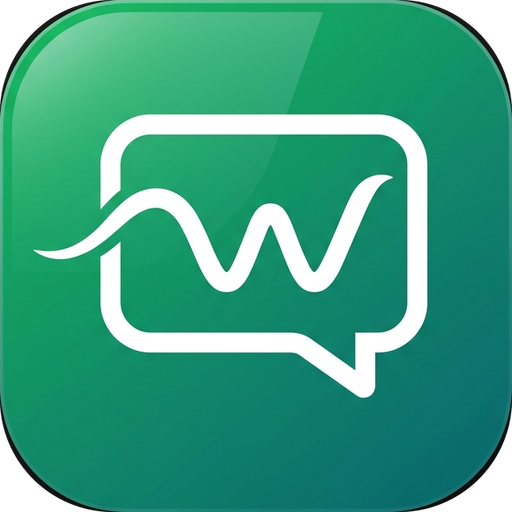

<p align="center">
  
</p>

<h2 align="center">WaDesk - Lightweight Native WhatsApp Client for Windows</h2>

<p align="center">
  Built in 100% Native Rust with WebView2. Zero Electron. Zero bloat. Ultra-secure.
</p>

---

## 🚀 Overview

**WaDesk** is a senior-engineered, lightweight native Windows desktop wrapper for WhatsApp Web built with **Rust** and Microsoft Edge **WebView2**.

Unlike typical Electron-based desktop wrappers that consume 200MB+ disk space and bundle full Chromium copies, **WaDesk** compiles down to a single **~1.1 MB** executable with native Win32 windowing, DWM dark mode, system tray integration, and hardware-backed DPAPI security.

---

## ✨ Features & Highlights

| Feature | Details |
| :--- | :--- |
| **Ultra-Lightweight** | Single standalone binary **~1.1 MB** with zero GC overhead |
| **Official Visuals** | Native official WhatsApp green branding on window frame, taskbar, and tray |
| **Multiple Accounts** | Independent sessions (`%APPDATA%\WaDesk\profiles\<id>`), each with its own storage, session, and tray icon |
| **System Tray & Context Menu** | Minimize to tray, left-click/double-click restore, and right-click popup context menu |
| **Notification Balloons** | Intercepts web notifications and renders native Windows System Tray balloons |
| **Desktop Hotkeys** | `Ctrl+Shift+P` (Privacy Blur), `Ctrl+Shift+A` (Account Switcher), `Ctrl+M` (Minimize) |
| **Navigation Guard** | External links in chats are automatically routed to your default Windows web browser |
| **DWM Dark Mode** | Native Windows immersive dark title bar and Explorer frame theme |
| **EcoQoS & Memory Trimming** | Automatically throttles CPU power and trims browser memory level when minimized to tray |
| **Audio Mixer Integration** | Renames the Windows Core Audio WASAPI session to "WhatsApp" in Windows Volume Mixer |
| **Model Context Protocol (MCP)** | Built-in loopback MCP server (`2025-06-18`) & REST `/api/send` for AI agent interaction |
| **Security Hardening** | CSPRNG token generation (`OsRng`), constant-time bearer verification (`subtle`), and Windows **DPAPI encryption** |
| **Auto-Detect WebView2** | Detects runtime availability with an automatic prompt to install Microsoft Evergreen Bootstrapper if missing |

---

## 🛠️ Keyboard Shortcuts

| Shortcut | Action |
| :--- | :--- |
| <kbd>Ctrl</kbd> + <kbd>Shift</kbd> + <kbd>P</kbd> | Toggle **Privacy Blur Mode** (blur chats & contact names in public) |
| <kbd>Ctrl</kbd> + <kbd>Shift</kbd> + <kbd>A</kbd> | Open **Account Switcher** modal |
| <kbd>Ctrl</kbd> + <kbd>M</kbd> | Minimize directly to System Tray |

---

## 🤖 MCP / AI Agent Access

Each running profile of WaDesk exposes an embedded **Model Context Protocol (MCP)** server on `http://127.0.0.1:5987` (or fallback port):

The endpoint URL and encrypted bearer token are securely managed at:
```text
%APPDATA%\WaDesk\mcp.json
%APPDATA%\WaDesk\mcp_token
```

Supported MCP tools for AI agents:
* `app_status`
* `list_chats`
* `open_chat`
* `read_messages`
* `conversation_summary`
* `send_message`
* `export_chat`

---

## 📂 Data Storage

All profile cookies, session tokens, and local cache are stored strictly locally:
```text
%APPDATA%\WaDesk\UserData                  # Primary account session
%APPDATA%\WaDesk\profiles\<id>\UserData    # Secondary account sessions
%APPDATA%\WaDesk\accounts.json             # Account manifest
%APPDATA%\WaDesk\window.json               # Window dimensions & positions memory
```

---

## 📦 Building from Source

### Prerequisites:
- [Rust](https://rustup.rs/) (1.80+ recommended)
- Windows 10/11 with WebView2 Runtime

### Build Release:
```powershell
# Run unit & integration tests
cargo test

# Build optimized release binary
cargo build --release
```
The output binary will be created at `target\release\wadesk.exe`.

---

## 📄 License

MIT or Apache-2.0. Not affiliated with or endorsed by WhatsApp LLC or Meta Platforms, Inc.
